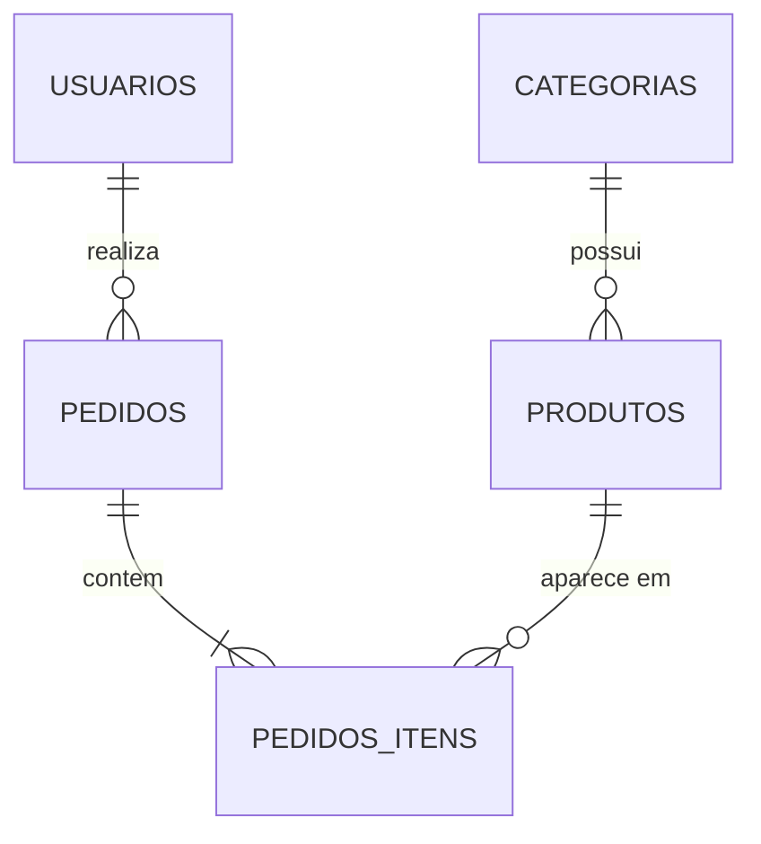

# Milka Mics
 
Loja virtual de artesanato, com vitrine, carrinho, finalização de pedidos, área do cliente e painel administrativo.
 
Projeto acadêmico em PHP e MySQL, rodando em Docker.
 
## Sumário
 
1. [Equipe](#equipe)
2. [Tecnologias](#tecnologias)
3. [Como rodar o projeto](#como-rodar-o-projeto)
4. [Funcionalidades](#funcionalidades)
5. [Regras de negócio](#regras-de-negócio)
6. [Estrutura de pastas](#estrutura-de-pastas)
7. [Banco de dados](#banco-de-dados)
8. [Fotos dos produtos](#fotos-dos-produtos)
9. [Testes](#testes)
10. [Próximos passos](#próximos-passos)
11. [Problemas comuns](#problemas-comuns)
## Equipe
 
- **Back-end:** Diego
- **Front-end:** Jonatas
## Tecnologias
 
- PHP 8.2 com Apache
- MySQL 8.0
- phpMyAdmin
- Docker e Docker Compose
- HTML, CSS e JavaScript
## Como rodar o projeto
 
### Pré-requisitos
 
- [Docker Desktop](https://www.docker.com/products/docker-desktop/) instalado e aberto
- [VS Code](https://code.visualstudio.com/) (recomendado)
### Passo a passo
 
1. Clone o repositório e abra a pasta no VS Code.
2. No terminal, dentro da pasta do projeto, rode:
```bash
docker compose up -d
```
 
> Em instalações antigas do Docker, o comando pode ser `docker-compose` (com hífen).
 
Na primeira vez, o Docker baixa as imagens e cria o banco com os arquivos da pasta `banco/`. Isso pode levar alguns minutos.
 
Se alterar o `Dockerfile`, use:
 
```bash
docker compose up -d --build
```
 
### Endereços
 
| O quê | Endereço |
|---|---|
| Site | http://localhost |
| Painel administrativo | http://localhost/admin.php |
| phpMyAdmin | http://localhost:8081 (usuário `root`, senha `root`) |
 
### Conta de administrador de teste
 
| E-mail | Senha |
|---|---|
| `admin@loja.com` | `123456` |
 
Use apenas para desenvolvimento.
 
### Comandos úteis
 
```bash
docker compose up -d        # iniciar o projeto
docker compose down         # parar o projeto (apaga os dados do banco)
docker compose logs -f      # ver os logs
docker compose ps           # ver os serviços em execução
```
 
### Recriar o banco
 
Os arquivos da pasta `banco/` só são executados quando o banco é criado do zero. Para aplicar alterações nos `.sql`, rode `docker compose down` seguido de `docker compose up -d`.
 
## Funcionalidades
 
### Cliente
 
- Cadastro de conta e login.
- Página inicial com banners (`index.php`).
- Catálogo (`produtos.php`), com busca, filtro por categoria e ordenação (mais recentes, menor preço, maior preço e nome).
- Página do produto (`produto.php`), com foto, descrição, preço, aviso de estoque baixo e botão **Adicionar ao carrinho**.
- Carrinho (`carrinho.php`), com alteração de quantidades, remoção (quantidade 0) e total.
- Finalização de pedido, que exige login.
- **Meus pedidos** (`meus_pedidos.php`), com status e itens de cada pedido.
### Administrador
 
- **Painel** (`admin.php`), com contagem de contas, administradores e itens.
- **Produtos** (`admin/produtos/`): listar, cadastrar, alterar (inclusive a foto) e excluir.
- **Usuários** (`admin_usuarios.php` e `editar_usuario.php`): listar, editar dados, tornar admin ou cliente e excluir.
- **Pedidos** (`admin/pedidos/listar.php`): listar, filtrar por status e trocar o status.
### API
 
`api/produtos.php` devolve, em JSON, os produtos ativos e com estoque.
 
```
GET /api/produtos.php?busca=croche&pagina=1&por_pagina=12
```
 
| Parâmetro | Descrição | Padrão |
|---|---|---|
| `busca` | Texto a pesquisar no nome, na descrição ou na categoria | vazio |
| `pagina` | Número da página | 1 |
| `por_pagina` | Itens por página (máximo 50) | 12 |
 
## Regras de negócio
 
| Situação | Comportamento |
|---|---|
| Produto inativo | Não aparece na vitrine e não pode ser comprado |
| Produto sem estoque | Não aparece na API. No catálogo (`produtos.php`), continua visível; na página do produto aparece "Produto esgotado." e o botão de compra some |
| Quantidade acima do estoque | O carrinho recusa, e a finalização também |
| Finalização com produto indisponível | Nenhum pedido é gravado |
| Preço do pedido | Sempre lido do banco no momento da compra |
| Cancelar pedido | Devolve as quantidades ao estoque |
| Reativar pedido cancelado | Baixa o estoque de novo, se houver quantidade suficiente |
| Excluir produto que está em pedidos | Recusado; o produto deve ser desativado |
| Excluir usuário com pedidos | Recusado |
| Admin excluir ou rebaixar a própria conta | Bloqueado |
| E-mail repetido na edição de usuário | Recusado |
 
### Aviso de estoque
 
| Estoque | Mensagem na página do produto |
|---|---|
| 0 | "Produto esgotado." |
| 1 | "Última unidade!" |
| 2 ou 3 | "Últimas N unidades!" |
| 4 ou mais | Nenhuma |
 
## Estrutura de pastas
 
```
Projeto/
├── admin/                       # Área administrativa
│   ├── _topo.php                # Cabeçalho comum das telas do admin
│   ├── _rodape.php              # Rodapé comum das telas do admin
│   ├── index.php                # Redireciona para admin.php
│   ├── produtos/                # Cadastro, alteração, exclusão e listagem
│   └── pedidos/listar.php       # Pedidos e troca de status
├── api/
│   └── produtos.php             # Endpoint JSON da vitrine
├── assets/
│   ├── css/                     # admin.css, cabecalho.css e style.css
│   ├── images/banners/          # Banners da página inicial
│   ├── images/produtos/         # Fotos dos produtos
│   ├── images/logo-milka.png    # Logo
│   ├── images/logo-milka-cabecalho.png  # Logo do cabeçalho
│   └── js/script.js
├── banco/
│   ├── 01_estrutura.sql         # Criação das tabelas
│   └── 02_dados.sql             # Dados iniciais
├── config/
│   ├── auth.php                 # exigir_admin(), flash(), exibir_flash(), e()
│   ├── carrinho.php             # Carrinho, CSRF e aviso de estoque
│   ├── conexao.php              # Conexão com o MySQL
│   ├── verifica_acesso.php      # Verificação de acesso (usada pelo admin.php)
│   └── vitrine.php              # Consulta de produtos da API
├── includes/
│   └── cabecalho.php            # Cabeçalho do site
├── admin.php                    # Painel administrativo
├── admin_usuarios.php           # Lista de usuários
├── editar_usuario.php           # Edição de dados de usuário
├── carrinho.php                 # Página do carrinho
├── carrinho_acao.php            # Adicionar e atualizar itens
├── finalizar.php                # Criação do pedido
├── meus_pedidos.php             # Pedidos do cliente
├── index.php                    # Página inicial
├── produtos.php                 # Catálogo
├── produto.php                  # Página do produto
├── cadastro.php                 # Cadastro de conta
├── cadastro_salvar.php          # Grava a nova conta
├── sign_in.php                  # Tela de login
├── recebe.php                   # Valida o login e abre a sessão
├── logout.php                   # Encerra a sessão
├── docker-compose.yml
├── Dockerfile
└── README.md
```
 
## Banco de dados
 
Nome do banco: `ProjetoDados`.
 
| Tabela | Para que serve |
|---|---|
| `USUARIOS` | Dados pessoais, endereço e tipo da conta (`cliente` ou `admin`) |
| `CATEGORIAS` | Categorias dos produtos |
| `PRODUTOS` | Nome, descrição, preço, estoque, foto e status (ativo ou inativo) |
| `PEDIDOS` | Pedidos, com status `pendente`, `atendido` ou `cancelado`, e cópia do endereço de entrega |
| `PEDIDOS_ITENS` | Itens de cada pedido, com quantidade e preço no momento da compra |
 

 
## Fotos dos produtos
 
- Ficam em `assets/images/produtos/`.
- A tabela `PRODUTOS` guarda só o nome do arquivo, no campo `IMAGEM`.
- Formatos aceitos: JPG, PNG e WEBP, com até 10 MB.
- Fotos enviadas pelo admin recebem um nome gerado, como `produto_d5e65c7520224a0e.png`.
- O limite de upload é definido no `Dockerfile`.
## Testes
 
Os testes são manuais. Já foram verificados:
 
| Área | O que foi testado |
|---|---|
| Conta | Cadastro e login; isolamento entre clientes em "Meus pedidos" |
| Compra | Adicionar ao carrinho e finalizar pedido; aviso de estoque e "Produto esgotado." |
| Pedidos (admin) | Pedido aparecendo no painel, troca de status e filtros por status; cancelamento devolvendo estoque; bloqueio da reativação sem estoque suficiente |
| Usuários (admin) | Edição de dados, com validação de e-mail duplicado; exclusão de usuário sem pedidos; bloqueio de exclusão com pedidos vinculados |
| Produtos e API | Alteração de foto; limite de upload de 10 MB; endpoint JSON |
 
## Próximos passos
 
- Carrinho lateral, que permite ver e alterar o carrinho sem sair da página.
- Botão **Adicionar ao carrinho** também na listagem de produtos.
- Cancelamento de pedido pelo cliente.
- Escolha de outro endereço de entrega e pagamento online.
- Confirmação de pedido por e-mail.
- Testes automatizados.
## Problemas comuns
 
**Porta 80, 3306 ou 8081 já em uso**
Feche outros servidores (XAMPP, WAMP ou outro MySQL) ou troque a porta no `docker-compose.yml`.
 
**O site não abre**
Confira se o Docker Desktop está aberto e rode `docker compose ps`. Os três serviços devem estar ativos.
 
**Erro de conexão com o banco logo após subir**
O MySQL demora para iniciar. Aguarde cerca de 30 segundos e recarregue a página.
 
**Aviso "headers already sent"**
Algum arquivo tem linha em branco ou espaço antes do `<?php`. A primeira linha do arquivo precisa ser `<?php`.
 
**Foto não aparece**
Confira se o nome do arquivo no banco (`PRODUTOS.IMAGEM`) é igual ao nome do arquivo em `assets/images/produtos/`, incluindo maiúsculas.
 
**Alterei um `.sql` e nada mudou**
Veja a seção [Recriar o banco](#recriar-o-banco).
 